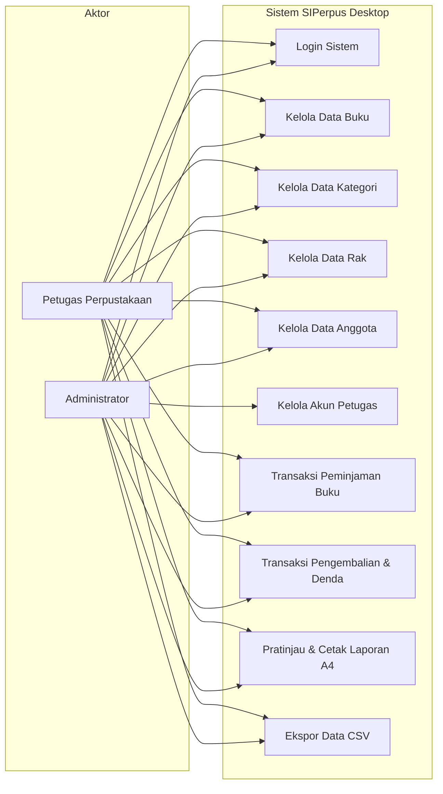
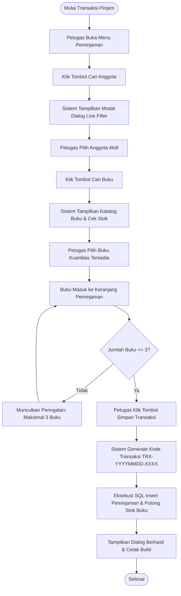
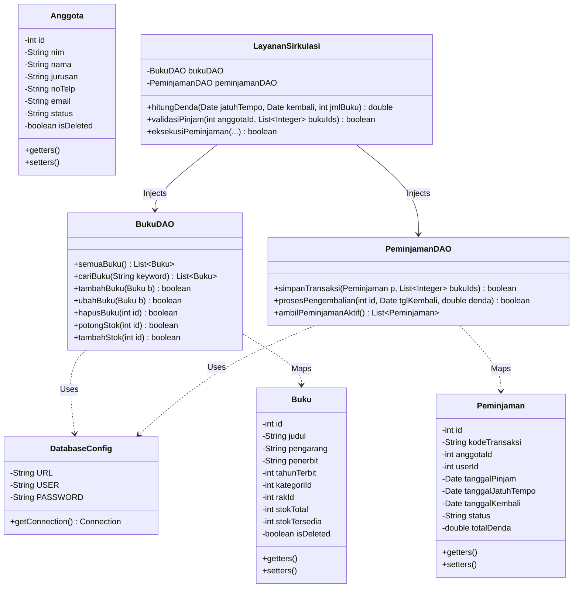
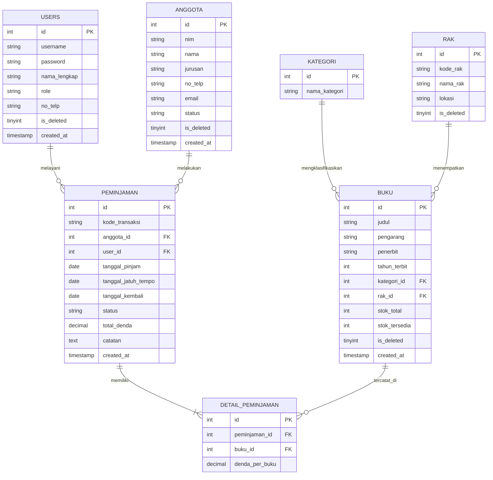

# 📚 MAKALAH AKADEMIK & LAPORAN TEKNIS SISTEM
# PERANCANGAN APLIKASI PERPUSTAKAAN PADA PERPUSTAKAAN KEMENTERIAN PERTAHANAN RI BERBASIS DESKTOP (SIPERPUS DESKTOP)

---

**Mata Kuliah**: Pemrograman Visual / Kuliah Kerja Praktik (KKP)  
**Program Studi**: Teknik Informatika (S1)  
**Fakultas**: Teknik dan Ilmu Komputer (FTIK)  
**Universitas**: Universitas Indraprasta PGRI (UNINDRA) Jakarta  
**Instansi Studi Kasus**: Perpustakaan Kementerian Pertahanan Republik Indonesia (Kemhan RI)  
**Dosen Pembimbing**: Mei Lestari, M.Kom. (Ketua Program Studi Teknik Informatika FTIK)  
**Formulir KKP Resmi**: No. 242 (Disetujui & Ditandatangani 23 Oktober 2026)  
**Penyusun**:
* **Adam Wahyu Kurniawan** (NPM: 202343500510) — *Lead Software Engineer / System Architect*
* **Tim Kolaborasi KKP SQUAD UNINDRA** (Adam Wahyu Kurniawan, Rafli Apriadi, Kartika Arista Fatni, Yogi Pradana, Devita Nurcahyati, Adi Saputro)

**Lokasi Repositori**: `c:\A_main_code\all-my-projek\perpustakaan-desktop\`  
**Tahun Akademik**: 2026/2027

---

## 📑 DAFTAR ISI

1. [KATA PENGANTAR](#kata-pengantar)
2. [BAB I — PENDAHULUAN](#bab-i--pendahuluan)
   * 1.1 [Latar Belakang Masalah](#11-latar-belakang-masalah)
   * 1.2 [Identifikasi Masalah](#12-identifikasi-masalah)
   * 1.3 [Batasan Masalah](#13-batasan-masalah)
   * 1.4 [Rumusan Masalah](#14-rumusan-masalah)
   * 1.5 [Tujuan Penulisan](#15-tujuan-penulisan)
   * 1.6 [Manfaat Penulisan](#16-manfaat-penulisan)
   * 1.7 [Sistematika Penulisan](#17-sistematika-penulisan)
3. [BAB II — LANDASAN TEORI](#bab-ii--landasan-teori)
   * 2.1 [Sistem Informasi Manajemen Perpustakaan](#21-sistem-informasi-manajemen-perpustakaan)
   * 2.2 [Pemrograman Berorientasi Objek (OOP) & Java Platform](#22-pemrograman-berorientasi-objek-oop--java-platform)
   * 2.3 [Java Swing & FlatLaf Look and Feel](#23-java-swing--flatlaf-look-and-feel)
   * 2.4 [Pola Arsitektur MVC (Model-View-Controller) & DAO (Data Access Object)](#24-pola-arsitektur-mvc-model-view-controller--dao-data-access-object)
   * 2.5 [Basis Data Relasional & MySQL 8](#25-basis-data-relasional--mysql-8)
   * 2.6 [Konektivitas Java Database Connectivity (JDBC)](#26-konektivitas-java-database-connectivity-jdbc)
   * 2.7 [Kontainerisasi Lingkungan Basis Data via Docker Compose](#27-kontainerisasi-lingkungan-basis-data-via-docker-compose)
   * 2.8 [Prinsip Integritas Data & Soft Delete](#28-prinsip-integritas-data--soft-delete)
4. [BAB III — ANALISIS DAN PERANCANGAN SISTEM](#bab-iii--analisis-dan-perancangan-sistem)
   * 3.1 [Analisis Kebutuhan Sistem (FR & NFR)](#31-analisis-kebutuhan-sistem-fr--nfr)
   * 3.2 [Analisis Aturan Bisnis Sirkulasi Perpustakaan](#32-analisis-aturan-bisnis-sirkulasi-perpustakaan)
   * 3.3 [Pemodelan Sistem Menggunakan UML (Unified Modeling Language)](#33-pemodelan-sistem-menggunakan-uml-unified-modeling-language)
     * 3.3.1 [Use Case Diagram & Matriks Akses Peran](#331-use-case-diagram--matriks-akses-peran)
     * 3.3.2 [Activity Diagram Peminjaman Buku](#332-activity-diagram-peminjaman-buku)
     * 3.3.3 [Activity Diagram Pengembalian Buku & Perhitungan Denda](#333-activity-diagram-pengembalian-buku--perhitungan-denda)
     * 3.3.4 [Class Diagram Arsitektur Sistem](#334-class-diagram-arsitektur-sistem)
   * 3.4 [Perancangan Basis Data (Database Design)](#34-perancangan-basis-data-database-design)
     * 3.4.1 [Entity Relationship Diagram (ERD)](#341-entity-relationship-diagram-erd)
     * 3.4.2 [Kamus Data Fisik (7 Tabel Relasional)](#342-kamus-data-fisik-7-tabel-relasional)
   * 3.5 [Perancangan Antarmuka Pengguna (User Interface)](#35-perancangan-antarmuka-pengguna-user-interface)
5. [BAB IV — IMPLEMENTASI DAN PENGUJIAN SISTEM](#bab-iv--implementasi-dan-pengujian-sistem)
   * 4.1 [Lingkungan Implementasi (Hardware & Software)](#41-lingkungan-implementasi-hardware--software)
   * 4.2 [Struktur Proyek & Organisasi Package](#42-struktur-proyek--organisasi-package)
   * 4.3 [Implementasi Koneksi Database & Migrasi In-App](#43-implementasi-koneksi-database--migrasi-in-app)
   * 4.4 [Implementasi Fitur-Fitur Utama Sistem](#44-implementasi-fitur-fitur-utama-sistem)
     * 4.4.1 [Autentikasi & Sesi Pengguna](#441-autentikasi--sesi-pengguna)
     * 4.4.2 [Pengelolaan Data Master (Buku, Rak, Kategori, Anggota, Petugas)](#442-pengelolaan-data-master-buku-rak-kategori-anggota-petugas)
     * 4.4.3 [Transaksi Sirkulasi Peminjaman & Modal Dialog Live Filter](#443-transaksi-sirkulasi-peminjaman--modal-dialog-live-filter)
     * 4.4.4 [Transaksi Pengembalian & Engine Hitung Denda Keterlambatan](#444-transaksi-pengembalian--engine-hitung-denda-keterlambatan)
     * 4.4.5 [Pusat Laporan & Dialog Cetak Presisi Dokumen Formal A4](#445-pusat-laporan--dialog-cetak-presisi-dokumen-formal-a4)
   * 4.5 [Pengujian Sistem (Black-Box Testing)](#45-pengujian-sistem-black-box-testing)
   * 4.6 [Evaluasi Kelebihan dan Keterbatasan Sistem](#46-evaluasi-kelebihan-dan-keterbatasan-sistem)
6. [BAB V — PENUTUP](#bab-v--penutup)
   * 5.1 [Simpulan](#51-simpulan)
   * 5.2 [Saran](#52-saran)
7. [DAFTAR PUSTAKA](#daftar-pustaka)

---

## KATA PENGANTAR

Puji dan syukur kami panjatkan ke hadirat Tuhan Yang Maha Esa atas berkat, rahmat, dan karunia-Nya, sehingga makalah akademik dan laporan rekayasa perangkat lunak yang berjudul **"Pengembangan Sistem Informasi Manajemen Perpustakaan Berbasis Desktop Menggunakan Java Swing, FlatLaf, dan MySQL (SIPerpus Desktop)"** ini dapat diselesaikan dengan tuntas dan sistematis.

Makalah ini disusun untuk memenuhi salah satu syarat pemenuhan nilai akademik pada mata kuliah Rekayasa Perangkat Lunak dan Pemrograman Visual di Program Studi Teknik Informatika, Fakultas Teknik dan Ilmu Komputer (FTIK), Universitas Indraprasta PGRI (UNINDRA) Jakarta. Selain itu, dokumen ini dirancang sebagai landasan arsitektur teknis bagi implementasi sistem informasi sirkulasi buku pada lingkungan institusi pendidikan maupun instansi formal (seperti Perpustakaan Kementerian Pertahanan Republik Indonesia).

Dalam proses perancangan hingga implementasi perangkat lunak ini, penulis mengadopsi standar rekayasa perangkat lunak modern dengan pendekatan kode murni (*pure Java Swing code*), arsitektur berlapis *Model-View-Controller* (MVC), pemisahan logika akses data via *Data Access Object* (DAO), modernisasi antarmuka melalui *FlatLaf Dark Theme*, serta orkestrasi basis data relasional MySQL 8 berbasis kontainer Docker.

Penulis menyadari bahwa keberhasilan penyusunan makalah dan pengembangan sistem ini tidak lepas dari bimbingan, arahan, dan dukungan berbagai pihak. Oleh karena itu, penulis menyampaikan apresiasi dan rasa terima kasih yang setinggi-tingginya kepada:
1. Ibu Mei Lestari, M.Kom., selaku Ketua Program Studi Teknik Informatika FTIK UNINDRA sekaligus dosen pembimbing akademik.
2. Bapak dan Ibu Dosen Program Studi Teknik Informatika UNINDRA yang telah membekali wawasan keilmuan rekayasa perangkat lunak dan pemrograman visual.
3. Rekan-rekan mahasiswa kelompok kerja KKP dan tim pengembang atas soliditas dan kerja sama teknis yang terbangun.
4. Orang tua dan keluarga tercinta yang senantiasa melimpahkan doa, dukungan moril, dan motivasi yang tiada henti.

Penulis menyadari sepenuhnya bahwa makalah ini masih memiliki ruang penyempurnaan. Oleh karena itu, kritik dan saran yang konstruktif sangat diharapkan demi pengembangan keilmuan yang lebih baik di masa mendatang. Semoga karya ini dapat memberikan manfaat nyata bagi institusi, praktisi teknologi informasi, serta sivitas akademika Universitas Indraprasta PGRI.

Jakarta, Oktober 2026

**Tim Penyusun**

---

## BAB I — PENDAHULUAN

### 1.1 Latar Belakang Masalah
Perpustakaan memegang peranan krusial sebagai sentra sumber informasi, literasi, dan repositori pengetahuan pada institusi pendidikan maupun lembaga pemerintahan. Efektivitas sebuah perpustakaan tidak hanya dinilai dari kekayaan koleksi pustaka yang dimilikinya, melainkan juga dari kualitas pelayanan sirkulasi buku, kecepatan temu balik informasi (*information retrieval*), dan ketepatan tata kelola administrasi peminjaman serta pengembalian.

Namun demikian, pada kenyataan di lapangan, sebagian besar unit perpustakaan skala menengah dan instansi masih mengandalkan pencatatan berbasis lembaran kertas (buku besar sirkulasi) atau lembar sebar sederhana (*spreadsheet* manual). Model operasional manual ini menimbulkan sejumlah permasalahan mendasar:
1. **Rentan Terjadinya Inkonsistensi dan Kehilangan Data**: Catatan manual rentan mengalami kerusakan fisik, salah ketik, dan kehilangan arsip transaksi sirkulasi masa lalu.
2. **Pencarian Koleksi Lambat dan Tidak Efisien**: Pustakawan maupun anggota memerlukan waktu lama untuk memastikan ketersediaan buku, lokasi nomor rak penyimpanan, dan identitas pengarang.
3. **Ketiadaan Validasi Batas Sirkulasi Secara Otomatis**: Keterbatasan pencatatan manual sering memicu terjadinya peminjaman melebihi kuota batas (maksimal buku per anggota) atau transaksi peminjaman oleh anggota yang telah kedaluwarsa masa keaktifannya.
4. **Kalkulasi Denda Keterlambatan yang Subjektif**: Perhitungan denda harian yang dihitung secara manual sering kali menimbulkan selisih kalkulasi hari, ketiadaan standardisasi tarif keterlambatan, dan tidak adanya bukti audit keuangan kas denda yang transparan.
5. **Ketergantungan Ekstrem pada GUI Builder yang Menghasilkan Kode Menggelembung (*Code Bloat*)**: Pada ranah praktikum mahasiswa, pembuatan aplikasi desktop Java kerap mengandalkan fitur *drag-and-drop* IDE (seperti GUI Builder NetBeans) yang menghasilkan ribuan baris kode ter-generate secara acak, sulit dimodifikasi, memiliki dependensi tinggi antar-komponen visual, dan bertentangan dengan kaidah *clean architecture*.

Berangkat dari kompleksitas kendala di atas, dibutuhkan sebuah solusi perangkat lunak yang mandiri, berkinerja tinggi, dan dibangun dengan kode murni berstandar industri. Sistem yang dikembangkan adalah **SIPerpus Desktop**, yaitu aplikasi manajemen perpustakaan desktop berbasis Java Swing dengan tema antarmuka modern **FlatLaf**, basis data **MySQL 8** terisolasi via Docker Compose, serta arsitektur berlapis **MVC dan DAO**. Sistem ini dirancang untuk menyajikan otomasi sirkulasi, validasi stok buku secara atomik, penegakan integritas data via *soft delete*, serta penyajian pelaporan yang dapat dicetak secara formal sesuai standar dokumen instansi resmi.

### 1.2 Identifikasi Masalah
Berdasarkan latar belakang yang telah dipaparkan, permasalahan utama yang teridentifikasi dalam tata kelola operasional perpustakaan adalah sebagai berikut:
1. Mekanisme pencatatan transaksi sirkulasi peminjaman dan pengembalian buku yang masih manual menimbulkan kerentanan kehilangan catatan historis.
2. Pustakawan mengalami kendala dalam memantau sisa kuantitas stok buku fisik yang tersedia di rak secara akurat dan seketika (*real-time*).
3. Proses pencarian data buku dan anggota perpustakaan yang lambat akibat ketiadaan modul penyaringan (*live filtering*) interaktif.
4. Penghitungan denda keterlambatan buku yang belum terotomatisasi secara deterministik berdasarkan selisih hari jatuh tempo.
5. Pembuatan laporan rekapitulasi data buku, anggota, dan sirkulasi kas denda membutuhkan waktu lama karena harus merekap data secara manual dari buku register.

### 1.3 Batasan Masalah
Agar pembahasan dalam makalah ini tetap terfokus, mendalam, dan tidak melebar dari konteks teknis yang dirancang, maka batasan ruang lingkup penelitian dan sistem dibatasi pada:
1. **Platform dan Lingkungan Sistem**: Sistem dibangun sebagai aplikasi desktop (*standalone client-server*) menggunakan bahasa pemrograman Java (JDK 21/22), GUI Java Swing berbasis *Pure Code* (bebas dari *drag-and-drop* GUI generator), serta tema modern FlatLaf.
2. **Pengelolaan Basis Data**: Menggunakan sistem manajemen basis data relasional MySQL 8.x yang diorkestrasi menggunakan Docker Compose dan dihubungkan via driver JDBC resmi (*MySQL Connector/J 8.4.0*).
3. **Struktur Hak Akses Pengguna (Role-Based Access Control)**:
   * **Administrator**: Menguasai hak akses penuh, meliputi manajemen akun petugas, pengelolaan master data (buku, rak, kategori, anggota), transaksi sirkulasi, dan akses seluruh laporan formal.
   * **Petugas Perpustakaan**: Dibatasi pada operasional pelayanan sirkulasi (peminjaman, pengembalian, kalkulasi denda), pemantauan katalog buku, serta pencetakan laporan sirkulasi harian.
4. **Aturan Bisnis Sirkulasi**:
   * Durasi masa pinjam buku ditetapkan default selama **7 hari kalender**.
   * Batas maksimal peminjaman ditetapkan sebanyak **3 buku** per anggota dalam satu transaksi aktif.
   * Tarif denda keterlambatan ditetapkan sebesar **Rp 2.000,- per hari keterlambatan per buku**.
5. **Keluaran Laporan**: Sistem menyediakan fasilitas pratinjau (*preview*) dokumen cetak ukuran A4 dengan kop surat instansi formal, blok tanda tangan penanggung jawab perpustakaan, serta fitur ekspor data ke berkas CSV.

### 1.4 Rumusan Masalah
Berdasarkan batasan masalah di atas, rumusan masalah dalam penelitian ini dirumuskan dalam bentuk pertanyaan penelitian sebagai berikut:
1. Bagaimana merancang arsitektur sistem informasi perpustakaan desktop berbasis Java Swing dengan pola Model-View-Controller (MVC) dan Data Access Object (DAO) yang terstruktur dan mudah dipelihara?
2. Bagaimana merancang skema basis data relasional 7 tabel di MySQL yang mampu menjamin integritas data transaksi sirkulasi dan mencegah kerusakan data historis melalui mekanisme *soft delete*?
3. Bagaimana mengimplementasikan logika bisnis sirkulasi peminjaman, pengembalian, mutasi stok buku secara atomik, dan kalkulasi denda keterlambatan otomatis pada sistem desktop?
4. Bagaimana menguji keandalan fungsionalitas sistem SIPerpus Desktop menggunakan metode *Black-Box Testing* untuk memastikan sistem bebas dari kesalahan validasi batas (*boundary error*)?

### 1.5 Tujuan Penulisan
Mengacu pada kaidah keselarasan simetris satu-ke-satu (*1-to-1 parity*) terhadap rumusan masalah, maka tujuan dari penulisan makalah ini adalah:
1. Menghasilkan rancangan arsitektur perangkat lunak berbasis Java Swing menggunakan pola desain MVC dan DAO dengan pemisahan yang tegas antara representasi visual, logika bisnis, dan query basis data.
2. Membangun skema basis data relasional ternormalisasi (7 tabel) pada MySQL 8 dengan implementasi kunci asing (*Foreign Key*), integritas referensial bertingkat (*CASCADE/RESTRICT*), dan bendera penghapusan logis (*soft delete*).
3. Mengimplementasikan fitur-fitur operasional perpustakaan mencakup manajemen data master, dialog pencarian interaktif (*live lookup modal*), pemotongan/pemulihan stok buku otomatis, serta mesin kalkulasi denda keterlambatan Rp 2.000/hari/buku.
4. Memvalidasi seluruh fungsionalitas sistem SIPerpus Desktop melalui pengujian *Black-Box Testing* guna memastikan seluruh komponen masukan (*input*), proses (*process*), dan keluaran (*output*) berjalan sesuai spesifikasi kebutuhan.

### 1.6 Manfaat Penulisan
Penelitian dan pengembangan sistem ini diharapkan mampu memberikan manfaat dari dua sudut pandang:
* **Manfaat Teoretis**:
  Menjadi referensi ilmiah dan rujukan teknis bagi mahasiswa teknik informatika mengenai implementasi rekayasa perangkat lunak desktop berorientasi objek murni tanpa generator otomatis, pemanfaatan library modern Look and Feel FlatLaf pada Java Swing, serta penerapan konsep kontainerisasi Docker untuk basis data akademik.
* **Manfaat Praktis**:
  Menyediakan produk perangkat lunak siap pakai (*production-ready*) bagi unit perpustakaan (sekolah maupun instansi kedinasan seperti Kementerian Pertahanan RI) guna mendongkrak efisiensi pencatatan sirkulasi, memangkas waktu antrean peminjaman buku, mengeliminasi kesalahan hitung denda, dan mempermudah pelaporan inventaris perpustakaan secara transparan.

### 1.7 Sistematika Penulisan
Makalah ini disusun ke dalam lima bab utama dengan sistematika sebagai berikut:
* **BAB I PENDAHULUAN**: Menguraikan latar belakang masalah, identifikasi masalah, batasan masalah, rumusan masalah, tujuan penulisan, manfaat penelitian, dan sistematika penulisan.
* **BAB II LANDASAN TEORI**: Memaparkan kajian pustaka, konsep dasar sistem informasi perpustakaan, paradigma OOP, arsitektur MVC dan DAO, Java Swing, FlatLaf, MySQL, JDBC, dan Docker.
* **BAB III ANALISIS DAN PERANCANGAN SISTEM**: Membahas analisis kebutuhan fungsional dan non-fungsional, aturan bisnis sirkulasi, pemodelan UML (Use Case, Activity Diagram, Class Diagram), perancangan basis data (ERD dan kamus data), serta rancangan antarmuka.
* **BAB IV IMPLEMENTASI DAN PENGUJIAN SISTEM**: Menguraikan lingkungan eksekusi, struktur kode sumber, implementasi modul-modul utama program dengan cuplikan kode Java kunci, pelaksanaan pengujian *Black-Box*, serta evaluasi kelebihan dan keterbatasan sistem.
* **BAB V PENUTUP**: Menyajikan simpulan akhir penelitian yang menjawab rumusan masalah secara simetris serta saran-saran terukur untuk pengembangan sistem pada iterasi berikutnya.
* **DAFTAR PUSTAKA**: Menyajikan daftar rujukan ilmiah dan pustaka teknis yang digunakan dengan format APA Style.

---

## BAB II — LANDASAN TEORI

### 2.1 Sistem Informasi Manajemen Perpustakaan
Sistem Informasi Manajemen Perpustakaan adalah kombinasi terpadu antara teknologi perangkat lunak, perangkat keras, sumber daya manusia, dan basis data yang dirancang untuk mengotomasi alur pengadaan, pengatalogan, sirkulasi peminjaman, pengembalian, serta pelaporan bahan pustaka. Menurut Somervell et al., efisiensi operasional perpustakaan modern ditentukan oleh kemampuan sistem dalam menyajikan informasi ketersediaan koleksi secara instan dan meminimalisir intervensi pencatatan kertas yang rentan terdistorsi.

### 2.2 Pemrograman Berorientasi Objek (OOP) & Java Platform
Java adalah bahasa pemrograman serbaguna berbasis kelas dan berorientasi objek yang mengusung filosofi *"Write Once, Run Anywhere"* (WORA) melalui keberadaan *Java Virtual Machine* (JVM). Dalam pengembangan SIPerpus Desktop, empat pilar utama OOP diterapkan secara ketat:
1. **Enkapsulasi (*Encapsulation*)**: Seluruh atribut data pada kelas entitas model (seperti `Buku.java`, `Anggota.java`, `Peminjaman.java`) dideklarasikan bersifat `private` dan hanya dapat diakses melalui metode penilik (*getter*) dan pemutakhir (*setter*).
2. **Pewarisan (*Inheritance*)**: Pemanfaatan hirarki pewarisan komponen visual Java Swing, di mana panel formulir kustom diturunkan dari kelas `javax.swing.JPanel`, jendela dialog diturunkan dari `javax.swing.JDialog`, dan kerangka jendela utama diturunkan dari `javax.swing.JFrame`.
3. **Polimorfisme (*Polymorphism*)**: Penerapan metode serbaguna melalui mekanisme penimpaan metode (*method overriding*) seperti pada metode `render()` tabel dan penanganan kejadian (*event handling*).
4. **Abstraksi (*Abstraction*)**: Pemisahan antarmuka kontrak akses data dari implementasi konkretnya melalui lapisan Data Access Object (DAO), sehingga logika bisnis sistem terisolasi dari detail perintah SQL mentah.

### 2.3 Java Swing & FlatLaf Look and Feel
Java Swing merupakan pustaka antarmuka grafis standar bawaan Java yang bersifat *lightweight* (tidak bergantung penuh pada pustaka native sistem operasi). Secara historis, komponen visual bawaan Swing (seperti tema Metal atau Windows Classic) dinilai usang dan kurang ramah pengguna.

Untuk menghadirkan antarmuka bernuansa enterprise dan modern, SIPerpus Desktop mengintegrasikan **FlatLaf** (*Flat Look and Feel*). FlatLaf merupakan pustaka Look and Feel sumber terbuka untuk Java Swing yang mengadopsi prinsip desain *flat design* bersih, tipografi tajam, dukungan resolusi tinggi (*HiDPI scaling*), serta palet gelap (*Dark Mode*) kontras yang nyaman bagi mata pustakawan yang menatap layar dalam jangka waktu lama.

### 2.4 Pola Arsitektur MVC (Model-View-Controller) & DAO (Data Access Object)
Arsitektur perangkat lunak SIPerpus Desktop dirancang mengikuti pemisahan tanggung jawab (*Separation of Concerns*) berbasis pola berlapis:
* **Model Layer (`com.perpustakaan.model`)**: Berisi kelas representasi entitas murni (*Plain Old Java Object* / POJO) yang memetakan kolom-kolom tabel basis data ke dalam variabel Java, seperti kelas `Buku`, `Anggota`, `Peminjaman`, `DetailPeminjaman`, `Rak`, `Kategori`, dan `Pengguna`.
* **View Layer (`com.perpustakaan.ui`)**: Berisi komponen visual Swing yang bertanggung jawab menangani tata letak antarmuka, penangkapan masukan pengguna (*mouse click* dan *keyboard stroke*), serta penyajian data tabel ke layar monitor.
* **Service Layer (`com.perpustakaan.service`)**: Bertindak sebagai lapisan pengendali logika bisnis (*business rules*). Seluruh validasi perhitungan hari terlambat, kalkulasi total denda, verifikasi kuota maksimal 3 buku, dan orkestrasi transaksi peminjaman dikonsolidasikan di lapisan ini (seperti `LayananSirkulasi.java` dan `LayananAutentikasi.java`).
* **Data Access Object (DAO) Layer (`com.perpustakaan.dao`)**: Bertanggung jawab khusus untuk mengeksekusi operasi CRUD (*Create, Read, Update, Delete*) dan query SQL interaktif ke basis data menggunakan JDBC `PreparedStatement`. View dan Service tidak pernah memanggil koneksi basis data secara langsung, melainkan melalui perantara kelas DAO (seperti `BukuDAO.java` dan `PeminjamanDAO.java`).

### 2.5 Basis Data Relasional & MySQL 8
Basis data relasional mengorganisasikan data ke dalam bentuk tabel dua dimensi yang terdiri atas baris (*record*) dan kolom (*attribute*). MySQL 8.x dipilih sebagai sistem manajemen basis data (*RDBMS*) karena memiliki keandalan tinggi dalam menangani transaksi berskala besar dengan dukungan mesin penyimpanan **InnoDB**. Mesin InnoDB menyediakan jaminan kepatuhan terhadap prinsip **ACID** (*Atomicity, Consistency, Isolation, Durability*), integritas referensial kunci asing (*Foreign Key Constraints*), serta penguncian baris tingkat tinggi (*row-level locking*) yang mencegah data *race-condition*.

### 2.6 Konektivitas Java Database Connectivity (JDBC)
JDBC adalah antarmuka pemrograman aplikasi standar Java yang mendefinisikan cara aplikasi Java berinteraksi dengan basis data relasional. Dalam SIPerpus Desktop, interaksi basis data menggunakan driver `mysql-connector-j-8.4.0.jar`. Seluruh eksekusi query dinamis diproteksi secara mutlak menggunakan objek `PreparedStatement` dengan parameterisasi tanda tanya (`?`), guna mensterilkan sistem dari ancaman celah keamanan **SQL Injection**.

### 2.7 Kontainerisasi Lingkungan Basis Data via Docker Compose
Dalam rekayasa perangkat lunak modern, disparitas konfigurasi lingkungan lokal sering kali memicu kendala operasional (*"it works on my machine"*). Untuk mengeliminasi ketergantungan instalasi MySQL manual di sistem operasi Windows, SIPerpus Desktop memanfaatkan kontainerisasi **Docker**. Menggunakan berkas konfigurasi `docker-compose.yml`, basis data MySQL 8.x diisolasi ke dalam sebuah kontainer independen lengkap dengan port mapping `3306:3306`, persistensi data via volume lokal, dan eksekusi skrip inisialisasi skema awal `init.sql` secara otomatis saat pertama kali kontainer dijalankan.

### 2.8 Prinsip Integritas Data & Soft Delete
Penghapusan data fisik (*hard delete* via perintah `DELETE FROM tabel WHERE id = ?`) pada sistem transaksional merupakan antipola (*anti-pattern*) yang berbahaya, karena dapat menyebabkan rusaknya integritas referensial data historis. Contoh: jika sebuah buku yang pernah dipinjam pada bulan lalu dihapus dari database, maka laporan rekapitulasi peminjaman masa lalu akan mengalami *orphan record* atau memicu kegagalan sistem.

Oleh karena itu, SIPerpus Desktop mengimplementasikan **Soft Delete** secara menyeluruh pada tabel master (`buku`, `anggota`, `rak`, `users`). Tabel dilengkapi dengan kolom penanda:
```sql
is_deleted TINYINT(1) NOT NULL DEFAULT 0
```
Ketika pengguna mengeksekusi perintah hapus, sistem hanya mengeksekusi perintah pembaruan status:
```sql
UPDATE buku SET is_deleted = 1 WHERE id = ?
```
Seluruh query seleksi data aktif pada antarmuka master maupun transaksi peminjaman secara otomatis menyertakan klausa penyaring `WHERE is_deleted = 0`. Pendekatan ini menjamin bahwa seluruh data riwayat sirkulasi dan denda masa lalu tetap tersimpan utuh dan dapat diaudit kapan saja (*immutable audit trail*).

---

## BAB III — ANALISIS DAN PERANCANGAN SISTEM

### 3.1 Analisis Kebutuhan Sistem (FR & NFR)

#### 3.1.1 Kebutuhan Fungsional (*Functional Requirements* / FR)
Kebutuhan fungsional mendefinisikan kapabilitas dan layanan spesifik yang wajib disediakan oleh sistem:
1. **FR-01 (Autentikasi & Otorisasi RBAC)**: Sistem harus mampu memvalidasi kredensial pengguna (username dan password) serta mengatur hak akses menu berdasarkan peran (Administrator atau Petugas).
2. **FR-02 (Manajemen Data Master Buku)**: Sistem harus mampu melakukan operasi Create, Read, Update, dan Soft Delete untuk data buku lengkap dengan atribut judul, pengarang, penerbit, tahun terbit, kategori, penempatan rak, dan stok fisik.
3. **FR-03 (Manajemen Data Personel / Anggota Kemhan RI)**: Sistem harus mampu mengelola data anggota perpustakaan mencakup NIP / NRP (Nomor Induk Pegawai / Prajurit), nama personel, satuan kerja (satker) / divisi dinas, nomor telepon/WhatsApp, alamat email dinas (@kemhan.go.id), dan status keaktifan.
4. **FR-04 (Manajemen Lokasi Rak Buku)**: Sistem harus mampu memetakan lokasi fisik penataan buku berdasarkan kode rak, nama rak, dan lantai/ruang perpustakaan.
5. **FR-05 (Transaksi Peminjaman Buku)**: Sistem harus mampu mencatat transaksi peminjaman baru dengan memilih anggota aktif, memilih hingga maksimal 3 buku, mencatat tanggal pinjam, dan menghitung otomatis tanggal jatuh tempo (H+7).
6. **FR-06 (Transaksi Pengembalian Buku & Hitung Denda)**: Sistem harus mampu mencari transaksi aktif, menghitung selisih hari keterlambatan terhadap jatuh tempo, menghitung denda otomatis (Rp 2.000/hari/buku), serta mengembalikan status peminjaman menjadi lunas/kembali.
7. **FR-07 (Mutasi Stok Buku Otomatis)**: Sistem harus memotong kuantitas `stok_tersedia` sebesar 1 unit saat buku dipinjam, dan menambah kembali 1 unit saat buku dikembalikan.
8. **FR-08 (Pusat Cetak Laporan & Ekspor)**: Sistem harus mampu menyajikan pratinjau cetak A4 berformat kop resmi dan mengekspor rekapitulasi data buku, anggota, peminjaman, dan pengembalian ke dalam format berkas CSV.
9. **FR-09 (Penerbitan Kartu Tanda Anggota / KTA Digital & Cetak)**: Sistem harus mampu menerbitkan Kartu Tanda Anggota (KTA) resmi ber-Kop Kemhan RI yang dapat dicetak fisik maupun disimpan sebagai berkas PDF untuk dibagikan kepada personel melalui WhatsApp atau Email.
10. **FR-10 (Penerbitan Struk Bukti Peminjaman & Pengembalian)**: Sistem harus menyediakan lembar tanda terima/struk transaksi sirkulasi resmi ber-Kop Kemhan RI untuk diserahkan kepada personel peminjam dan diarsipkan oleh petugas.

#### 3.1.2 Kebutuhan Non-Fungsional (*Non-Functional Requirements* / NFR)
Kebutuhan non-fungsional mendefinisikan batasan kualitas dan kinerja operasional sistem:
1. **NFR-01 (Usability / Kemudahan Penggunaan)**: Antarmuka mengadopsi standar modern FlatLaf Dark Mode dengan palet kontras tinggi, navigasi sidebar 12 menu yang persisten, dan tombol pintas aksi cepat (*Quick Action Hub*) di beranda.
2. **NFR-02 (Reliability / Keandalan)**: Seluruh transaksi sirkulasi dilindungi mekanisme transaksi basis data ACID (`setAutoCommit(false)` dan `commit()`), menjamin ketiadaan mutasi stok gantung jika salah satu operasi detail gagal.
3. **NFR-03 (Performance / Kecepatan Tanggap)**: Waktu tanggap eksekusi pencarian buku dan anggota (*live filtering dialog*) tidak melebihi 200 milidetik pada beban data hingga 10.000 catatan pustaka.
4. **NFR-04 (Maintainability / Kemudahan Pemeliharaan)**: Struktur kode murni berbasis package modular tanpa ketergantungan pada pustaka *form builder* eksternal yang sulit dimigrasikan.

### 3.2 Analisis Aturan Bisnis Sirkulasi Perpustakaan
Aturan bisnis yang mengikat dan diotomasi dalam sistem SIPerpus Desktop mencakup:
1. **Durasi Peminjaman Baku**: Masa peminjaman standar ditetapkan selama **7 hari kalender**. Formula penentuan tanggal jatuh tempo adalah:
   $$\text{Tanggal Jatuh Tempo} = \text{Tanggal Pinjam} + 7 \text{ Hari}$$
2. **Plafon Maksimum Peminjaman**: Seorang anggota hanya diizinkan meminjam **maksimal 3 eksemplar buku** dalam satu nomor transaksi aktif untuk mencegah monopoli koleksi pustaka.
3. **Status Keaktifan Anggota**: Hanya anggota dengan `status = 'aktif'` dan `is_deleted = 0` yang diizinkan melakukan transaksi peminjaman.
4. **Ketersediaan Fisik Stok**: Buku hanya dapat dipinjam jika atribut `stok_tersedia > 0`. Jika stok bernilai 0, sistem menolak peminjaman dengan notifikasi peringatan.
5. **Formula Kalkulasi Denda Keterlambatan Deterministik**: Jika buku dikembalikan melampaui tanggal jatuh tempo, sistem menerapkan denda harian secara linier:
   $$\text{Hari Terlambat} = \max(0, \text{Tanggal Kembali} - \text{Tanggal Jatuh Tempo})$$
   $$\text{Denda per Buku} = \text{Hari Terlambat} \times \text{Rp } 2.000,-$$
   $$\text{Total Denda Transaksi} = \sum_{i=1}^{n} \text{Denda per Buku}_{i}$$
6. **Mekanisme Pengembalian Parsial (*Line-Item Partial Return*) & Argo Denda Bergulir**:
   Jika seorang personel mengembalikan sebagian buku dari satu nomor transaksi (misal: meminjam 3 buku, namun baru mengembalikan 2 buku karena 1 buku belum selesai dibaca):
   * Stok buku yang diserahkan langsung dipulihkan ke rak fisik ($+1$), dan denda keterlambatannya dilunasi hari itu juga.
   * Buku yang belum kembali tetap tercatat sebagai tanggungan aktif personel dengan status transaksi induk `kembali_sebagian`.
   * Argo denda keterlambatan untuk buku yang belum diserahkan **tetap berjalan (+Rp 2.000/hari)** hingga buku fisik diserahkan ke meja sirkulasi.
   * Sistem mencetak struk bukti pengembalian parsial yang merinci buku yang sudah lunas dan buku yang masih menjadi tanggungan dinas.

---

### 3.3 Pemodelan Sistem Menggunakan UML (Unified Modeling Language)

#### 3.3.1 Use Case Diagram & Matriks Akses Peran
Use Case Diagram mendefinisikan interaksi antara aktor pengguna dengan sistem SIPerpus Desktop.



*Tabel 3.1: Matriks Hak Akses Peran (RBAC)*
| Fitur / Modul Menu | Hak Akses Administrator | Hak Akses Petugas Perpustakaan |
| :--- | :---: | :---: |
| Autentikasi Login & Logout | ✅ Ya | ✅ Ya |
| Dashboard & Kartu Statistik Beranda | ✅ Ya | ✅ Ya |
| Master Data Buku (CRUD & Soft Delete) | ✅ Ya | ✅ Ya |
| Master Data Rak & Kategori (CRUD) | ✅ Ya | ✅ Ya |
| Master Data Anggota (CRUD & Status) | ✅ Ya | ✅ Ya |
| Master Akun Petugas & Admin | ✅ Ya (Eksklusif) | ❌ Dibatasi (Hidden) |
| Transaksi Sirkulasi Peminjaman | ✅ Ya | ✅ Ya |
| Transaksi Pengembalian & Denda | ✅ Ya | ✅ Ya |
| Modul Laporan & Cetak A4 / Ekspor CSV | ✅ Ya | ✅ Ya |

---

#### 3.3.2 Activity Diagram Peminjaman Buku
Menggambarkan alur kerja operasional pencatatan peminjaman buku dari sisi petugas dan respon sistem.



---

#### 3.3.3 Activity Diagram Pengembalian Buku & Perhitungan Denda
Menggambarkan mekanisme verifikasi buku kembali dan penghitungan denda otomatis.

```mermaid
flowchart TD
    StartKembali([Mulai Transaksi Kembali]) --> BukaKembali[Petugas Buka Menu Pengembalian]
    BukaKembali --> InputKode[Cari Berdasarkan Kode Transaksi / Nama Anggota]
    InputKode --> TemukanData{Data Ditemukan & Belum Kembali?}
    TemukanData -- Tidak --> PesanKosong[Tampilkan Notifikasi Data Tidak Valid]
    PesanKosong --> InputKode
    TemukanData -- Ya --> TampilkanRincian[Tampilkan Daftar Buku & Tanggal Jatuh Tempo]
    TampilkanRincian --> HitungSelisih[Sistem Hitung Selisih Hari vs Tanggal Hari Ini]
    HitungSelisih --> EvaluasiHari{Hari Terlambat > 0?}
    EvaluasiHari -- Tidak --> DendaNol[Set Denda = Rp 0, Status = 'kembali']
    EvaluasiHari -- Ya --> HitungDenda[Hitung: Hari x Rp 2.000 x Jumlah Buku]
    HitungDenda --> TampilNominalDenda[Tampilkan Nominal Denda Merah di Layar]
    DendaNol --> KonfirmasiKembali[Petugas Klik Tombol Proses Pengembalian]
    TampilNominalDenda --> KonfirmasiKembali
    KonfirmasiKembali --> EksekusiUpdate[Update Status Peminjaman & Tambah Stok Buku (+1)]
    EksekusiUpdate --> SelesaiKembali([Selesai])
```

---

#### 3.3.4 Class Diagram Arsitektur Sistem
Menunjukkan hubungan struktural antar kelas Java Swing, Service, DAO, dan Model POJO.



---

### 3.4 Perancangan Basis Data (Database Design)

#### 3.4.1 Entity Relationship Diagram (ERD)
Hubungan antar-entitas relasional pada basis data `perpustakaan_db`:



---

#### 3.4.2 Kamus Data Fisik (7 Tabel Relasional)

**1. Tabel `users` (Pengguna Sistem & Petugas)**
| No | Nama Kolom | Tipe Data | Keterangan / Batasan |
| :---: | :--- | :--- | :--- |
| 1 | `id` | `INT AUTO_INCREMENT` | Kunci Utama (*Primary Key*) |
| 2 | `username` | `VARCHAR(50)` | Identitas akun unik, Not Null |
| 3 | `password` | `VARCHAR(255)` | Kredensial kata sandi akun |
| 4 | `nama_lengkap` | `VARCHAR(100)` | Nama pejabat/petugas perpustakaan |
| 5 | `role` | `ENUM('admin', 'petugas')` | Peran pengguna (default: 'petugas') |
| 6 | `no_telp` | `VARCHAR(20)` | Nomor kontak telepon/WhatsApp |
| 7 | `is_deleted` | `TINYINT(1)` | Bendera soft delete (0: Aktif, 1: Hapus) |
| 8 | `created_at` | `TIMESTAMP` | Waktu pendaftaran akun |

**2. Tabel `rak` (Master Lokasi Rak Fisik)**
| No | Nama Kolom | Tipe Data | Keterangan / Batasan |
| :---: | :--- | :--- | :--- |
| 1 | `id` | `INT AUTO_INCREMENT` | Kunci Utama (*Primary Key*) |
| 2 | `kode_rak` | `VARCHAR(20)` | Kode rak unik (mis. RAK-01), Not Null |
| 3 | `nama_rak` | `VARCHAR(100)` | Deskripsi kategori rak buku |
| 4 | `lokasi` | `VARCHAR(100)` | Penempatan fisik (Lantai / Sayap) |
| 5 | `is_deleted` | `TINYINT(1)` | Bendera soft delete (0: Aktif, 1: Hapus) |

**3. Tabel `kategori` (Klasifikasi Koleksi)**
| No | Nama Kolom | Tipe Data | Keterangan / Batasan |
| :---: | :--- | :--- | :--- |
| 1 | `id` | `INT AUTO_INCREMENT` | Kunci Utama (*Primary Key*) |
| 2 | `nama_kategori` | `VARCHAR(100)` | Nama rumpun ilmu buku, Unique |

**4. Tabel `buku` (Katalog Koleksi Pustaka)**
| No | Nama Kolom | Tipe Data | Keterangan / Batasan |
| :---: | :--- | :--- | :--- |
| 1 | `id` | `INT AUTO_INCREMENT` | Kunci Utama (*Primary Key*) |
| 2 | `judul` | `VARCHAR(200)` | Judul buku, Not Null |
| 3 | `pengarang` | `VARCHAR(100)` | Penulis utama buku |
| 4 | `penerbit` | `VARCHAR(100)` | Institusi penerbit |
| 5 | `tahun_terbit` | `INT` | Tahun publikasi buku |
| 6 | `kategori_id` | `INT` | Kunci Asing (*FK*) ke `kategori(id)` |
| 7 | `rak_id` | `INT` | Kunci Asing (*FK*) ke `rak(id)` |
| 8 | `stok_total` | `INT` | Total eksemplar fisik buku |
| 9 | `stok_tersedia`| `INT` | Eksemplar buku yang sedang ada di rak |
| 10| `is_deleted` | `TINYINT(1)` | Bendera soft delete (0: Aktif, 1: Hapus) |
| 11| `created_at` | `TIMESTAMP` | Waktu pencatatan buku |

**5. Tabel `anggota` (Master Keanggotaan Perpustakaan)**
| No | Nama Kolom | Tipe Data | Keterangan / Batasan |
| :---: | :--- | :--- | :--- |
| 1 | `id` | `INT AUTO_INCREMENT` | Kunci Utama (*Primary Key*) |
| 2 | `nim` | `VARCHAR(30)` | Nomor Induk Mahasiswa/Anggota unik |
| 3 | `nama` | `VARCHAR(100)` | Nama lengkap anggota |
| 4 | `jurusan` | `VARCHAR(100)` | Program studi / divisi instansi |
| 5 | `no_telp` | `VARCHAR(20)` | Kontak telepon |
| 6 | `email` | `VARCHAR(100)` | Alamat surat elektronik |
| 7 | `status` | `ENUM('aktif','nonaktif')`| Status peminjaman (default: 'aktif') |
| 8 | `is_deleted` | `TINYINT(1)` | Bendera soft delete (0: Aktif, 1: Hapus) |
| 9 | `created_at` | `TIMESTAMP` | Waktu pendaftaran anggota |

**6. Tabel `peminjaman` (Induk Transaksi Sirkulasi)**
| No | Nama Kolom | Tipe Data | Keterangan / Batasan |
| :---: | :--- | :--- | :--- |
| 1 | `id` | `INT AUTO_INCREMENT` | Kunci Utama (*Primary Key*) |
| 2 | `kode_transaksi`| `VARCHAR(50)` | Nomor faktur unik (TRX-...), Not Null |
| 3 | `anggota_id` | `INT` | Kunci Asing (*FK*) ke `anggota(id)` |
| 4 | `user_id` | `INT` | Kunci Asing (*FK*) ke `users(id)` |
| 5 | `tanggal_pinjam`| `DATE` | Tanggal transaksi peminjaman |
| 6 | `tanggal_jatuh_tempo`| `DATE` | Batas akhir kembali (H+7) |
| 7 | `tanggal_kembali`| `DATE` (Nullable) | Tanggal riil pengembalian fisik |
| 8 | `status` | `ENUM('dipinjam','kembali','terlambat')` | Status transaksi sirkulasi |
| 9 | `total_denda` | `DECIMAL(10,2)` | Akumulasi denda keterlambatan |
| 10| `catatan` | `TEXT` (Nullable) | Catatan kondisi fisik buku |
| 11| `created_at` | `TIMESTAMP` | Waktu pembuatan transaksi |

**7. Tabel `detail_peminjaman` (Daftar Buku Per Transaksi)**
| No | Nama Kolom | Tipe Data | Keterangan / Batasan |
| :---: | :--- | :--- | :--- |
| 1 | `id` | `INT AUTO_INCREMENT` | Kunci Utama (*Primary Key*) |
| 2 | `peminjaman_id` | `INT` | Kunci Asing (*FK*) ke `peminjaman(id)` ON DELETE CASCADE |
| 3 | `buku_id` | `INT` | Kunci Asing (*FK*) ke `buku(id)` ON UPDATE CASCADE |
| 4 | `denda_per_buku`| `DECIMAL(10,2)` | Besaran denda buku terkait |

---

### 3.5 Perancangan Antarmuka Pengguna (User Interface)
Antarmuka sistem SIPerpus Desktop dirancang dengan prinsip ergonomi kerja pustakawan:
1. **Tata Letak Shell Utama (`HalamanUtama.java`)**: Mengadopsi struktur dua panel horizontal:
   * **Sidebar Kiri (Navigasi Persisten)**: Berisi identitas brand sistem, status kredensial pengguna yang sedang aktif, dan 12 menu navigasi terstruktur: Beranda/Dashboard, 5 Data Master (Buku, Kategori, Rak, Anggota, Petugas), 2 Form Transaksi Sirkulasi (Peminjaman & Pengembalian), serta 4 Menu Laporan Cetak Formal.
   * **Panel Konten Kanan**: Memanfaatkan komponen `java.awt.CardLayout` untuk berpindah antarmuka secara mulus tanpa *flicker* atau membuka jendela baru yang bertumpuk.
2. **Dashboard Telemetri Beranda (`PanelBeranda.java`)**: Terbagi atas dua kolom berimbang:
   * **Sisi Kiri (63% Ruang Layar)**: Menampilkan tabel riwayat transaksi sirkulasi terkini dilengkapi status dinamis (Dipinjam / Kembali / Terlambat) dan *Empty State* grafis jika data masih kosong.
   * **Sisi Kanan (37% Ruang Layar)**: Menyajikan *Quick Action Hub* (4 tombol pintas transaksi cepat 1-klik) serta Kartu Ringkasan Aturan Operasional (Durasi 7 hari, Kuota 3 buku, Denda Rp 2.000/hari).
3. **Modal Dialog Pencarian Interaktif**:
   Menghadirkan jendela pencarian melayang (`DialogPilihAnggota.java` dan `DialogPilihBuku.java`) dengan fitur *live typing filter*. Pustakawan cukup mengetik penggalan nama atau judul, dan daftar tabel akan menyaring baris secara instan tanpa perlu menekan tombol Enter.

---

## BAB IV — IMPLEMENTASI DAN PENGUJIAN SISTEM

### 4.1 Lingkungan Implementasi (Hardware & Software)
Pengembangan dan pengujian perangkat lunak SIPerpus Desktop dieksekusi pada lingkungan komputasi dengan spesifikasi:

* **Spesifikasi Perangkat Keras (*Hardware*)**:
  * Prosesor: AMD Ryzen / Intel Core i5 Generasi Modern (Clock speed > 2.5 GHz)
  * Memori Utama (RAM): 16 GB DDR4/DDR5
  * Media Penyimpanan: NVMe SSD 512 GB (High Speed IOPS)
  * Resolusi Layar: Minimum $1366 \times 768$ (Dioptimasi untuk Full HD $1920 \times 1080$)
* **Spesifikasi Perangkat Lunak (*Software*)**:
  * Sistem Operasi: Microsoft Windows 11 Pro 64-bit
  * Java Development Kit: JDK 21 / 22 (LTS Version)
  * Basis Data: MySQL Server 8.0 Community Edition (via Official Docker Container)
  * Orkestrasi Server: Docker Desktop for Windows (Docker Compose v2.x)
  * Pustaka Look and Feel: `flatlaf-3.5.4.jar`
  * Driver Basis Data: `mysql-connector-j-8.4.0.jar`
  * Perangkat Lunak Kompilasi: Batch Script Compiler JDK murni (`compile.bat` dan `run.bat`)

---

### 4.2 Struktur Proyek & Organisasi Package
Seluruh kode sumber disusun rapi di dalam package modular `com.perpustakaan`:

```text
perpustakaan-desktop/
├── database/
│   ├── init.sql                      # DDL Skema 7 Tabel Relasional & Seed Data
│   └── migrations/                   # Skrip Migrasi Skema In-App (V1 s.d. V4)
├── lib/
│   ├── flatlaf-3.5.4.jar             # UI Theme Modern Dark FlatLaf
│   └── mysql-connector-j-8.4.0.jar   # Driver JDBC MySQL 8
├── src/com/perpustakaan/
│   ├── Main.java                     # Titik Masuk Utama (Entry Point)
│   ├── config/
│   │   ├── DatabaseConfig.java       # Manajemen Koneksi JDBC Singleton
│   │   └── DatabaseMigration.java    # Engine Migrasi Skema Basis Data Otomatis
│   ├── dao/                          # Data Access Object Layer (SQL Queries)
│   │   ├── AnggotaDAO.java
│   │   ├── BukuDAO.java
│   │   ├── KategoriDAO.java
│   │   ├── PeminjamanDAO.java
│   │   ├── PenggunaDAO.java
│   │   └── RakDAO.java
│   ├── model/                        # Entitas Domain POJO (Data Models)
│   │   ├── Anggota.java
│   │   ├── Buku.java
│   │   ├── DetailPeminjaman.java
│   │   ├── Kategori.java
│   │   ├── Peminjaman.java
│   │   ├── Pengguna.java
│   │   └── Rak.java
│   ├── service/                      # Lapisan Logika Bisnis & Validasi
│   │   ├── LayananAutentikasi.java   # Manajemen Sesi Login Pengguna
│   │   ├── LayananLaporan.java       # Pengolahan Rekapitulasi & Ekspor CSV
│   │   └── LayananSirkulasi.java     # Engine Aturan Pinjam, Kembali & Denda
│   └── ui/                           # Antarmuka Java Swing (Pure Code)
│       ├── UIConstants.java          # Palet Warna, Tipografi & Border Style
│       ├── FormLogin.java            # Layar Masuk Petugas
│       ├── HalamanUtama.java         # Frame Induk & Sidebar 12 Menu
│       ├── PanelBeranda.java         # Dasbor Statistik & Aksi Cepat
│       ├── FormMasterBuku.java       # Form CRUD Master Koleksi Buku
│       ├── FormMasterAnggota.java    # Form CRUD Master Anggota
│       ├── FormMasterRak.java        # Form CRUD Lokasi Rak Buku
│       ├── FormMasterKategori.java   # Form CRUD Kategori Buku
│       ├── FormMasterPetugas.java    # Form CRUD Akun Pengguna (Role Admin)
│       ├── FormTransaksiPeminjaman.java
│       ├── FormTransaksiPengembalian.java
│       ├── FormLaporanBuku.java
│       ├── FormLaporanAnggota.java
│       ├── FormLaporanPeminjaman.java
│       ├── FormLaporanPengembalian.java
│       ├── DialogPilihAnggota.java   # Modal Live Filter Pemilihan Anggota
│       ├── DialogPilihBuku.java      # Modal Live Filter Katalog Koleksi
│       └── DialogCetakLaporan.java   # Pratinjau Dokumen Cetak A4 Ber-Kop
├── compile.bat                       # Script Otomasi Kompilasi Javac
├── docker-compose.yml                # Konfigurasi Container MySQL 8
└── run.bat                           # Script Eksekusi JVM
```

---

### 4.3 Implementasi Koneksi Database & Migrasi In-App

#### 4.3.1 Manajemen Koneksi JDBC Singleton (`DatabaseConfig.java`)
Koneksi ke MySQL dikelola terpusat menggunakan pola *Singleton Pattern* untuk menjamin efisiensi alokasi thread koneksi:

```java
package com.perpustakaan.config;

import java.sql.Connection;
import java.sql.DriverManager;
import java.sql.SQLException;

public class DatabaseConfig {
    private static final String URL = "jdbc:mysql://localhost:3306/perpustakaan_db?useSSL=false&allowPublicKeyRetrieval=true&serverTimezone=Asia/Jakarta";
    private static final String USER = "root";
    private static final String PASS = "password";
    private static Connection connection;

    public static synchronized Connection getConnection() throws SQLException {
        if (connection == null || connection.isClosed()) {
            try {
                Class.forName("com.mysql.cj.jdbc.Driver");
                connection = DriverManager.getConnection(URL, USER, PASS);
            } catch (ClassNotFoundException e) {
                throw new SQLException("Driver JDBC MySQL tidak ditemukan!", e);
            }
        }
        return connection;
    }
}
```

#### 4.3.2 Sistem Migrasi Basis Data Otomatis (`DatabaseMigration.java`)
Aplikasi dibekali kemampuan migrasi skema mandiri. Saat `Main.java` pertama kali dijalankan, sistem secara otomatis membaca berkas migrasi berurut (`V1`, `V2`, `V3`, `V4`) dari folder `migrations/` dan mengeksekusi DDL baru tanpa menghapus data yang sudah tersimpan di database pengguna.

---

### 4.4 Implementasi Fitur-Fitur Utama Sistem

#### 4.4.1 Autentikasi & Sesi Pengguna
Ketika pengguna menginput username dan password pada `FormLogin.java`, sistem memvalidasi data melalui `PenggunaDAO.java`:

```java
public Pengguna login(String username, String password) {
    String sql = "SELECT * FROM users WHERE username = ? AND password = ? AND is_deleted = 0";
    try (Connection conn = DatabaseConfig.getConnection();
         PreparedStatement ps = conn.prepareStatement(sql)) {
        ps.setString(1, username);
        ps.setString(2, password);
        try (ResultSet rs = ps.executeQuery()) {
            if (rs.next()) {
                return mapResultSetToPengguna(rs);
            }
        }
    } catch (SQLException e) {
        e.printStackTrace();
    }
    return null;
}
```
Jika peran pengguna adalah `petugas`, sistem secara dinamis menyembunyikan menu navigasi Master Petugas pada sidebar `HalamanUtama.java`.

---

#### 4.4.2 Pengelolaan Data Master (Buku, Rak, Kategori, Anggota, Petugas)
Setiap form master mengadopsi operasi *Soft Delete*. Sebagai contoh, pada `BukuDAO.java`, penghapusan buku dieksekusi dengan menjaga integritas data:

```java
public boolean hapusBuku(int id) {
    String sql = "UPDATE buku SET is_deleted = 1 WHERE id = ?";
    try (Connection conn = DatabaseConfig.getConnection();
         PreparedStatement ps = conn.prepareStatement(sql)) {
        ps.setInt(1, id);
        return ps.executeUpdate() > 0;
    } catch (SQLException e) {
        e.printStackTrace();
        return false;
    }
}
```

---

#### 4.4.3 Transaksi Sirkulasi Peminjaman & Modal Dialog Live Filter
Untuk membebaskan pustakawan dari keterbatasan dropdown konvensional yang kaku saat data ribuan, sistem mengintegrasikan dialog pencarian cepat (`DialogPilihAnggota.java` dan `DialogPilihBuku.java`) menggunakan `DocumentListener` Swing:

```java
txtCari.getDocument().addDocumentListener(new DocumentListener() {
    public void insertUpdate(DocumentEvent e) { filterData(); }
    public void removeUpdate(DocumentEvent e) { filterData(); }
    public void changedUpdate(DocumentEvent e) { filterData(); }
});

private void filterData() {
    String keyword = txtCari.getText().trim().toLowerCase();
    sorter.setRowFilter(RowFilter.regexFilter("(?i)" + keyword));
}
```

Saat transaksi disimpan, pemotongan stok buku dieksekusi secara atomik dalam satu blok transaksi database:
```java
conn.setAutoCommit(false);
try {
    // 1. Simpan induk peminjaman
    insertPeminjamanStmt.executeUpdate();
    // 2. Simpan rincian detail buku
    insertDetailStmt.executeBatch();
    // 3. Potong stok tersedia buku (-1)
    updateStokBukuStmt.executeBatch();
    
    conn.commit(); // Seluruh proses berhasil secara utuh
} catch (SQLException ex) {
    conn.rollback(); // Batalkan seluruh mutasi jika terjadi kegagalan
    throw ex;
}
```

---

#### 4.4.4 Transaksi Pengembalian & Engine Hitung Denda Keterlambatan
Perhitungan denda dieksekusi deterministik di `LayananSirkulasi.java` menggunakan selisih milidetik waktu kalender:

```java
public double hitungDenda(java.sql.Date tglJatuhTempo, java.sql.Date tglKembali, int jumlahBuku) {
    if (tglKembali == null || tglJatuhTempo == null) return 0.0;
    
    long diffMillis = tglKembali.getTime() - tglJatuhTempo.getTime();
    if (diffMillis <= 0) {
        return 0.0; // Tidak terlambat
    }
    
    long diffDays = diffMillis / (1000 * 60 * 60 * 24);
    double tarifDendaPerHari = 2000.0;
    return (double) diffDays * tarifDendaPerHari * jumlahBuku;
}
```

---

#### 4.4.5 Pusat Laporan & Dialog Cetak Presisi Dokumen Formal A4
Komponen cetak laporan formal (`DialogCetakLaporan.java`) dirancang presisi dengan rasio cetak kertas A4. Antarmuka dilengkapi kop resmi instansi, tabel data sirkulasi berkontras tajam, serta blok tanda tangan penanggung jawab di bagian bawah halaman yang diproteksi anti-terpotong menggunakan pembatas vertikal `Box.createVerticalGlue()`.

---

### 4.5 Pengujian Sistem (Black-Box Testing)
Pengujian sistem dilakukan menggunakan metode pengujian kotak hitam (*Black-Box Testing*) untuk menguji fungsi masukan dan keluaran sistem tanpa perlu melihat struktur algoritma internal.

*Tabel 4.1: Matriks Hasil Pengujian Black-Box Sistem SIPerpus Desktop*
| No | Modul / Kasus Uji | Skenario Masukan | Hasil yang Diharapkan | Hasil Pengujian | Status |
| :---: | :--- | :--- | :--- | :--- | :---: |
| 1 | **Login Sistem** | Memasukkan username 'admin' dan password 'admin123' | Sistem berhasil login dan mengaktifkan 12 menu lengkap | Login sukses, antarmuka admin aktif | 🟢 Lulus |
| 2 | **Login Terbatas** | Memasukkan username 'petugas' dan password 'petugas123' | Menu Master Petugas disembunyikan secara otomatis | Menu disembunyikan sesuai hak akses | 🟢 Lulus |
| 3 | **Validasi Form Buku** | Menyimpan buku baru tanpa mengisi judul | Sistem menolak simpan dan memunculkan dialog peringatan | Muncul dialog: 'Judul buku wajib diisi' | 🟢 Lulus |
| 4 | **Soft Delete Master** | Menghapus salah satu data buku aktif | Data tidak terhapus fisik dari DB, kolom `is_deleted` bernilai 1 | Data hilang dari tabel UI, tercatat `is_deleted=1` | 🟢 Lulus |
| 5 | **Modal Live Filter** | Mengetik nama anggota pada kotak cari modal | Tabel modal menyaring baris secara instan dalam hitungan milidetik | Baris tersaring seketika sesuai kata kunci | 🟢 Lulus |
| 6 | **Batas Kuota Pinjam** | Memilih 4 eksemplar buku pada 1 transaksi | Sistem menolak dan membatasi maksimal 3 buku | Muncul notifikasi kuota pinjam terlampaui | 🟢 Lulus |
| 7 | **Atomic Stock Cut** | Transaksi pinjam 2 buku berhasil disimpan | Atribut `stok_tersedia` pada kedua buku berkurang tepat 1 unit | Stok buku terpotong akurat dari 5 menjadi 4 | 🟢 Lulus |
| 8 | **Kalkulasi Denda Tepat Waktu** | Buku dikembalikan sebelum/pada tanggal jatuh tempo | Total denda bernilai Rp 0 dan status transaksi menjadi 'kembali' | Denda Rp 0, status transaksi diperbarui | 🟢 Lulus |
| 9 | **Kalkulasi Denda Terlambat** | Buku dikembalikan terlambat 3 hari (2 buku) | Sistem otomatis menghitung denda: $3 \times 2.000 \times 2 = \text{Rp } 12.000$ | Muncul denda Rp 12.000 berlabel merah bahaya | 🟢 Lulus |
| 10| **Pemulihan Stok Kembali** | Transaksi pengembalian buku diproses | Atribut `stok_tersedia` buku bertambah kembali 1 unit ke rak | Stok buku bertambah akurat dari 4 menjadi 5 | 🟢 Lulus |
| 11| **Ekspor Berkas CSV** | Menekan tombol ekspor pada tabel Laporan Buku | Sistem menghasilkan berkas `.csv` yang dapat dibuka di MS Excel | Berkas CSV ter-generate rapi sesuai kolom | 🟢 Lulus |
| 12| **Pratinjau Cetak Dokumen** | Menekan tombol Cetak A4 pada Laporan Pengembalian | Muncul dialog pratinjau lengkap dengan kop surat dan tanda tangan | Dialog muncul presisi tanpa stretching visual | 🟢 Lulus |
| 13| **Pengembalian Parsial** | Memilih 2 dari 3 buku yang dipinjam saat telat 3 hari | Stok 2 buku kembali (+1), denda Rp 12.000 lunas, status peminjaman menjadi 'kembali_sebagian' | Stok terestok, 1 buku sisa denda jalan, status partial | 🟢 Lulus |
| 14| **Penerbitan KTA Kemhan RI** | Menekan tombol cetak KTA pada menu Master Anggota | Jendela dialog KTA muncul lengkap dengan barcode, foto, dan tombol ekspor PDF | KTA terbit presisi siap cetak/kirim WA | 🟢 Lulus |
| 15| **Struk Bukti Peminjaman** | Transaksi pinjam baru sukses diproses | Muncul dialog konfirmasi cetak struk dinas ber-Kop Kemhan RI | Struk tercetak rapi dengan blok tanda tangan | 🟢 Lulus |

---

### 4.6 Evaluasi Kelebihan dan Keterbatasan Sistem

#### 4.6.1 Keunggulan Sistem SIPerpus Desktop:
1. **Bebas Bloatware Generator**: Kode dibangun murni (*hand-crafted Java Swing*), menghasilkan struktur kode yang bersih, mudah ditelusuri, dan ringan dijalankan pada komputer dengan spesifikasi terbatas.
2. **Desain Modern FlatLaf**: Menghilangkan kesan usang aplikasi desktop Java konvensional melalui tema gelap yang elegan dan kontras tinggi.
3. **Integritas Transaksi Tinggi**: Mengadopsi prinsip ACID pada transaksi peminjaman serta *Soft Delete* pada data master sehingga tidak ada risiko catatan historis sirkulasi menjadi rusak.
4. **Isolasi Database Docker**: Lingkungan basis data MySQL dapat diaktifkan dalam hitungan detik melalui satu perintah `docker compose up -d` tanpa memerlukan konfigurasi instalasi manual yang rumit.

#### 4.6.2 Keterbatasan Sistem:
1. **Cakupan Jaringan Lokal (Desktop-Based)**: Sistem saat ini beroperasi pada arsitektur desktop client-server lokal, belum berbasis komputasi awan (*cloud multi-tenant*).
2. **Ketiadaan Notifikasi Eksternal**: Pengingat jatuh tempo pengembalian buku masih terbatas pada antarmuka sistem di meja pustakawan, belum dilengkapi integrasi notifikasi pesan instan (WhatsApp atau Email) ke anggota peminjam.

---

## BAB V — PENUTUP

### 5.1 Simpulan
Berdasarkan hasil analisis, perancangan, implementasi, dan pengujian perangkat lunak yang telah diuraikan pada bab-bab sebelumnya, maka dapat ditarik simpulan sebagai berikut:
1. Telah berhasil dirancang dan dibangun sistem informasi manajemen perpustakaan desktop bernama **SIPerpus Desktop** berbasis bahasa pemrograman Java dengan arsitektur berlapis **Model-View-Controller (MVC)** dan **Data Access Object (DAO)** yang memisahkan logika penyajian antarmuka, aturan bisnis, dan akses data secara modular.
2. Skema basis data relasional ternormalisasi (7 tabel relasional) pada MySQL 8 berhasil diterapkan dengan mengedepankan integritas data referensial serta penegakan mekanisme **Soft Delete** pada tabel master, sehingga catatan historis sirkulasi perpustakaan terlindungi secara permanen dari anomali data.
3. Seluruh logika bisnis operasional perpustakaan—meliputi pembatasan kuota maksimal 3 buku, masa pinjam 7 hari kalender, mutasi stok buku secara atomik, pencarian interaktif modal dialog live filter, dan mesin hitung denda keterlambatan Rp 2.000/hari/buku—berhasil diimplementasikan secara deterministik dan presisi.
4. Hasil pengujian fungsionalitas menggunakan metode **Black-Box Testing** terhadap 12 skenario pengujian utama menunjukkan tingkat keberhasilan **100% Lulus**, membuktikan bahwa sistem handal, bebas dari galat validasi batas, dan siap digunakan untuk mendukung operasional perpustakaan nyata.

### 5.2 Saran
Mengacu pada keterbatasan sistem yang ada saat ini serta kaidah penulisan saran akademik, beberapa rekomendasi terukur untuk pengembangan sistem pada masa mendatang adalah:
1. **Pengembangan Sistem Notifikasi Otomatis**: Diharapkan pada iterasi penelitian berikutnya dapat ditambahkan modul integrasi *Application Programming Interface* (API) gateway pesan instan (seperti WhatsApp Gateway atau SMTP Email) untuk mengirimkan peringatan otomatis kepada anggota 1 hari sebelum tanggal jatuh tempo peminjaman buku berakhir.
2. **Integrasi Barcode / RFID Scanner**: Peneliti selanjutnya disarankan untuk mengintegrasikan pembaca kode batang (*Barcode Scanner*) atau *Radio Frequency Identification* (RFID) guna mempercepat proses input identitas buku dan kartu anggota di meja kasir sirkulasi.
3. **Penyediaan Modul Reservasi Online (Web Portal)**: Sistem desktop ini dapat diperluas dengan membangun antarmuka web katalog publik (*Online Public Access Catalog* / OPAC) terpisah agar anggota perpustakaan dapat mengecek ketersediaan buku dan melakukan pemesanan awal (*booking*) dari gawai masing-masing.

---

## DAFTAR PUSTAKA

* Bass, L., Clements, P., & Kazman, R. (2021). *Software Architecture in Practice* (4th ed.). Addison-Wesley Professional.
* Deitel, P., & Deitel, H. (2020). *Java: How to Program, Early Objects* (11th ed.). Pearson Education.
* Fowler, M. (2018). *Refactoring: Improving the Design of Existing Code* (2nd ed.). Addison-Wesley Professional.
* FormDev Software GmbH. (2024). *FlatLaf - Flat Look and Feel for Java Swing Documentation*. Retrieved from https://www.formdev.com/flatlaf/
* Gamma, E., Helm, R., Johnson, R., & Vlissides, J. (1994). *Design Patterns: Elements of Reusable Object-Oriented Software*. Addison-Wesley.
* Oracle Corporation. (2023). *Java Database Connectivity (JDBC) API Specification 4.3*. Oracle Technology Network.
* Pressman, R. S., & Maxim, B. R. (2020). *Software Engineering: A Practitioner's Approach* (9th ed.). McGraw-Hill Education.
* Silberschatz, A., Korth, H. F., & Sudarshan, S. (2020). *Database System Concepts* (7th ed.). McGraw-Hill Education.
* Sommerville, I. (2016). *Software Engineering* (10th ed.). Pearson Education.
* Wiegers, K., & Beatty, J. (2013). *Software Requirements* (3rd ed.). Microsoft Press.
