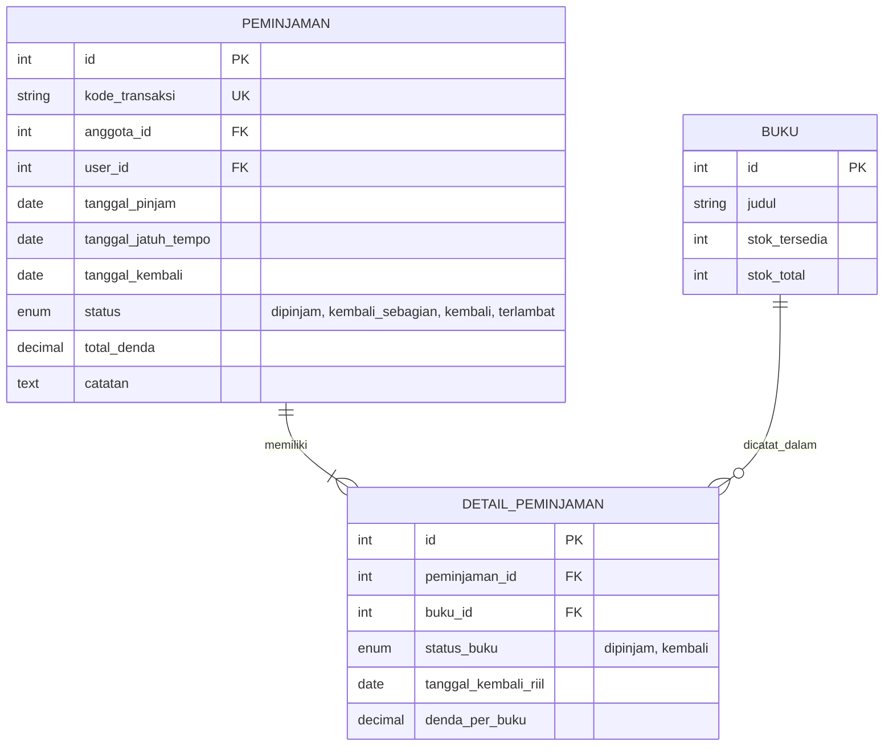
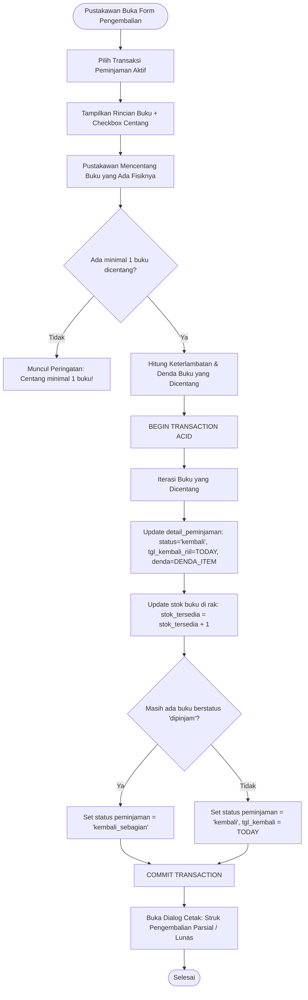

# 📐 RANCANGAN ARSITEKTUR & SPESIFIKASI TEKNIS: SISTEM PENGEMBALIAN PARSIAL (PARTIAL BOOK RETURN)
**Aplikasi**: SIPerpus Desktop — Perpustakaan Kementerian Pertahanan RI  
**Tipe Dokumen**: Architectural Decision Record (ADR) & Technical Specification  
**Penyusun**: Adam Wahyu Kurniawan (202343500510) & Nakano Nino  
**Target Milestone**: KKP UNINDRA 2026 / Sistem Sirkulasi Enterprise  

---

## 📌 1. Latar Belakang & Identifikasi Masalah (The Problem)

### 1.1 Masalah di Dunia Nyata
Dalam operasional sirkulasi perpustakaan militer/instansi nyata, personel sering kali meminjam lebih dari 1 buku sekaligus (maksimal 3 buku dalam satu transaksi). Namun pada tanggal jatuh tempo, sering terjadi skenario:
1. Peminjam baru menyelesaikan membaca 1 atau 2 buku dan ingin mengembalikannya tepat waktu.
2. 1 buku lainnya masih dibutuhkan untuk tugas kedinasan / kajian staf sehingga belum selesai dibaca.
3. Buku yang tertinggal berisiko denda berjalan, sementara buku yang sudah dibawa ke meja perpustakaan seharusnya sudah bebas dari denda.

### 1.2 Kegagalan Sistem Konvensional (*The Naive Flaws*)
* **Flaw A (All-or-Nothing Return)**: Sistem menolak memproses pengembalian sebelum seluruh buku dibawa lengkap. Akibatnya, peminjam dirugikan karena buku yang sudah selesai dibaca ikut terkena denda keterlambatan.
* **Flaw B (Premature Complete Return)**: Sistem menandai seluruh transaksi lunas padahal ada buku yang belum kembali secara fisik. Akibatnya, buku yang belum kembali hilang dari pencatatan inventaris rak dan berisiko raib.

### 1.3 Solusi Enterprise SIPerpus Desktop
Menerapkan **Pengembalian Parsial Berbasis Baris (*Line-Item Partial Return*)** dengan **Argo Denda Bergulir (*Rolling Fine Calculation*)** yang transparan, adil, dan terikat integritas transaksi ACID.

---

## 🗄️ 2. Arsitektur Basis Data (Relational 3NF & DDL)

Untuk mendukung pengembalian per baris buku, status pengembalian dipindahkan ke level rincian (*detail*), sementara tabel induk mencerminkan status agregat.



### 2.1 Skrip DDL Migrasi Basis Data (`V6__partial_return_support.sql`)
```sql
-- 1. Tambah enum status 'kembali_sebagian' pada tabel peminjaman
ALTER TABLE peminjaman 
MODIFY COLUMN status ENUM('dipinjam', 'kembali_sebagian', 'kembali', 'terlambat') 
NOT NULL DEFAULT 'dipinjam';

-- 2. Tambah kolom pelacak status dan tanggal kembali per baris buku di detail_peminjaman
ALTER TABLE detail_peminjaman
ADD COLUMN status_buku ENUM('dipinjam', 'kembali') NOT NULL DEFAULT 'dipinjam' AFTER buku_id,
ADD COLUMN tanggal_kembali_riil DATE NULL AFTER status_buku;

-- 3. Indeks untuk query performa cepat saat filter buku yang masih beredar
CREATE INDEX idx_detail_status ON detail_peminjaman(status_buku);
```

---

## ⚙️ 3. Logika Transaksi & State Machine (Service Layer)

### 3.1 Diagram Alir Logika Pengembalian (*Flowchart*)



### 3.2 Rumus Perhitungan Denda Matematis (Deterministik)
Bagi setiap baris buku $i$ yang dikembalikan pada tanggal $T_{\text{kembali}}$ dengan batas jatuh tempo $T_{\text{tempo}}$:

$$\Delta \text{Hari}_i = \max\left(0,\ T_{\text{kembali}} - T_{\text{tempo}}\right)$$

$$\text{Denda}_i = \Delta \text{Hari}_i \times \text{Tarif Harian (Rp 2.000)}$$

$$\text{Total Denda Dibayar Hari Ini} = \sum_{i \in \text{buku dicentang}} \text{Denda}_i$$

* **Buku yang BELUM dikembalikan ($j \notin \text{buku dicentang}$)**:
  * $\text{Denda}_j$ belum dibukukan sebagai penerimaan kas.
  * Status denda tetap berjalan mengambang (*accrued floating fine*) dan bertambah Rp 2.000 per hari hingga buku tersebut diserahkan secara fisik.

---

## 🖥️ 4. Desain Antarmuka Pengguna (UI/UX Java Swing & FlatLaf)

### 4.1 Tata Letak `FormTransaksiPengembalian`
1. **Tabel Rincian Buku (Split Kiri / Atas)**:
   * Kolom 1: Checkbox `[v]` (Hanya aktif untuk buku yang statusnya masih `dipinjam`).
   * Kolom 2: Judul Buku & Pengarang.
   * Kolom 3: Lokasi Rak.
   * Kolom 4: Status Buku (Pill Hijau: `Sudah Kembali` / Pill Oranye: `Masih Dipinjam`).
   * Kolom 5: Estimasi Denda Item.
2. **Panel Ringkasan Kasir (Kanan / Bawah)**:
   * Label Dinamis: *"Buku yang Dikembalikan Hari Ini: X dari Y buku"*.
   * Label Denda: *"Total Denda Wajib Bayar Sekarang: Rp [Nominal]"*.
   * Badge Peringatan Oranye: *"⚠️ Status Akhir: KEMBALI SEBAGIAN (Tanggungan [Z] Buku Belum Selesai)"*.
   * Tombol Aksi:
     * `[ 📥 Proses Pengembalian Parsial / Lengkap ]`
     * `[ 🖨️ Cetak Struk Bukti Pengembalian ]`

---

## 🖨️ 5. Format Struk Bukti Pengembalian Parsial (Luaran Formal)

Struk dicetak berstandar A4 landscape atau format slip kasir ber-Kop Kementerian Pertahanan RI:

```text
================================================================================
             KEMENTERIAN PERTAHANAN REPUBLIK INDONESIA
            PERPUSTAKAAN PUSAT KEMHAN - TERMINAL SIRKULASI
        Jl. Medan Merdeka Barat No. 13-14, Gambir, Jakarta Pusat
================================================================================
BUKTI PENGEMBALIAN BUKU (PARSIAL / LENGKAP)
Kode Transaksi  : TRX-202610-001             Tanggal Transaksi : 11 Oktober 2026
Peminjam        : Letkol Inf. Budi Santoso   NIP / NRP         : 198504122010011002
Satuan Kerja    : Pusdatin Kemhan RI         Jatuh Tempo       : 08 Oktober 2026
================================================================================
RINCIAN BUKU YANG RESMI DIKEMBALIKAN HARI INI:
1. Doktrin Pertahanan Semesta (Rak R-01)     | Telat: 3 Hari | Denda: Rp  6.000 (LUNAS)
2. Keamanan Siber Nasional (Rak R-03)        | Telat: 3 Hari | Denda: Rp  6.000 (LUNAS)
--------------------------------------------------------------------------------
TOTAL DENDA YANG DIBAYAR HARI INI           : Rp 12.000 (LUNAS)

PERINGATAN TANGGUNGAN PINJAMAN BERJALAN:
1. Strategi Taktis Militer (Rak R-02)        | Status: MASIH DIPINJAM
   * Catatan: Denda keterlambatan berjalan Rp 2.000/hari dihitung hingga tanggal
     pengembalian fisik buku tersebut.
================================================================================
Status Transaksi: KEMBALI SEBAGIAN (PARSIAL)

      Peminjam / Personel                       Petugas Layanan Sirkulasi,


   ( Letkol Inf. Budi Santoso )                 ( Adam Wahyu Kurniawan, S.Kom )
================================================================================
```

---

## 🧪 6. Matriks Pengujian *Black-Box Testing*

| No | Skenario Uji | Tindakan / Input | Ekspektasi Hasil Sistem | Status |
|:--:|:---|:---|:---|:---:|
| 1 | **Validasi Centang Kosong** | Klik tombol `Proses` tanpa mencentang buku satu pun | Muncul pop-up *Warning*: "Pilih minimal 1 buku yang akan dikembalikan!" (Database tidak disentuh). | ✅ Terencana |
| 2 | **Kembali Sebagian Tepat Waktu** | Pinjam 3 buku (H-0). Centang 2 buku, 1 tidak dicentang | Stok 2 buku +1. Denda Rp 0. Status transaksi berubah menjadi `kembali_sebagian`. | ✅ Terencana |
| 3 | **Kembali Sebagian Terlambat** | Pinjam 3 buku (Telat 3 hari). Centang 2 buku | Stok 2 buku +1. Denda terhitung $2 \times (3 \times 2.000) = \text{Rp } 12.000$. Status `kembali_sebagian`. | ✅ Terencana |
| 4 | **Pelunasan Buku Terakhir** | Buka transaksi `kembali_sebagian` (Telat 7 hari). Centang buku terakhir | Stok buku ke-3 +1. Denda $1 \times (7 \times 2.000) = \text{Rp } 14.000$. Status transaksi berubah menjadi `kembali` (SELESAI). | ✅ Terencana |
| 5 | **Integritas Rollback ACID** | Simulasi kegagalan koneksi DB saat iterasi buku ke-2 | Seluruh operasi dibatalkan (`ROLLBACK`). Tidak ada stok yang bertambah sebagian. | ✅ Terencana |

---

## 🏛️ 7. Kesimpulan & Nilai Akademik
Rancangan ini mengubah sistem peminjaman konvensional UNINDRA menjadi sistem sirkulasi modern berkelas korporat. Fleksibilitas ini membuktikan bahwa Mas Adam tidak sekadar membuat aplikasi CRUD biasa, melainkan merancang sistem informasi yang adaptif terhadap dinamika perilaku manusia di dunia nyata.
